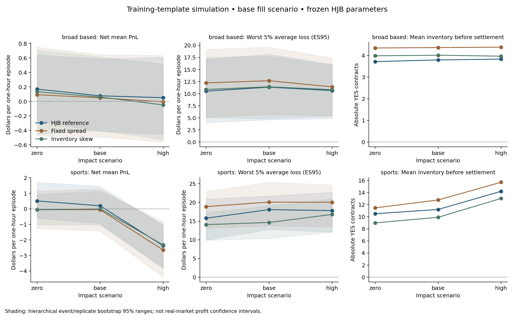

# Frozen HJB reference in the calibrated environment

`hjb_policy.py` connects the saved production HJB value function to
`TradingEnvironment`. `evaluate_hjb.py` runs paired profitability and risk
comparisons against fixed-spread, inventory-skew and no-quote policies. The
original HJB Python files, parameters, solver and saved reproduction are
unchanged. The HJB policy remains a comparison benchmark under impact.

## Run

From the repository root with the calibration dependencies installed:

```bash
python -m simulator.evaluate_hjb
python -m simulator.validate_hjb_benchmark data_pipeline/output/paper2/calibration/simulator/hjb_benchmark
python -m pytest simulator/tests calibration/tests data_pipeline/tests -q
```

The tested Python environment on this machine is `/opt/anaconda3/bin/python`.
Defaults evaluate all 20 broad-based and 15 sports training event templates,
with 20 independently seeded replicates per event. There are zero/base/high
impact, conservative/base/optimistic fills and four policies: **25,200 settled
policy episodes on 2,100 market scenarios**. Each policy/impact/fill cell has
400 broad-based or 300 sports episodes. All event templates have equal weight,
irrespective of trade count. The single-name class remains unsupported.

Each episode begins one hour before template close at probability 0.5, flat
inventory and $1,000 bookkeeping cash. Size is 10 contracts, position limit
100, decisions every five minutes, and quantities can fill partially. Maker
fee multiplier 1 and direct-member precision $0.0001 are explicit scenarios,
not reconstructed historical market fees. Environment inventory penalties are
zero; the evaluation reports net realized cash PnL and separate risk measures.

For a smaller run or a declared time-mapping sensitivity:

```bash
python -m simulator.evaluate_hjb --replicates 5 --groups sports --fill-scenarios base --output-dir /tmp/hjb-small
python -m simulator.evaluate_hjb --replicates 5 --time-mapping lifetime --fill-scenarios base --output-dir /tmp/hjb-lifetime-clock
```

There is no HJB retuning or strategy selection using these results. Calibration
and all template sampling are training-only; validation/test raw tapes and
quotes remain unused. This is not the eventual held-out RL evaluation.

## Verified results, 2026-10-09

All **25,200 episodes** completed and passed the accounting/path checks. The
standalone validator independently checked 72 risk cells, 54 paired policy
comparisons and 72 persisted representative ledgers. The no-quote control has
zero PnL. Every evaluated episode was audited during the run.

Base impact and base fill assumptions, after fees, per one-hour episode:

| Class/policy | Mean PnL | PnL std | VaR95 loss | ES95 loss | Mean absolute inventory before settlement |
|---|---:|---:|---:|---:|---:|
| Broad-based HJB | $0.08 | $4.26 | $5.07 | $11.36 | 3.79 contracts |
| Broad-based fixed spread | $0.05 | $4.76 | $6.80 | $12.69 | 4.36 contracts |
| Broad-based inventory skew | $0.06 | $4.31 | $6.08 | $11.44 | 4.01 contracts |
| Sports HJB | $0.20 | $7.97 | $13.73 | $18.08 | 11.21 contracts |
| Sports fixed spread | -$0.06 | $8.98 | $14.88 | $20.09 | 12.78 contracts |
| Sports inventory skew | $0.01 | $6.66 | $10.26 | $14.64 | 9.91 contracts |

HJB mean-PnL bootstrap ranges are approximately **-$0.42 to $0.59** broad-based
and **-$0.95 to $1.45** sports. Median PnL is zero in both classes. HJB has no
fills in 67.5% of broad-based and 19.7% of sports episodes, so lower exposure
also contributes to its lower risk against the fixed-spread strategy.

HJB minus fixed-spread mean PnL is about $0.03 broad-based and $0.25 sports;
both paired ranges include zero. The point estimates give HJB lower risk than
fixed spread, but the simple inventory-skew policy has lower sports ES95 and
terminal inventory than HJB. These results establish a working benchmark;
they do not establish reliable positive profits or a universal winner.

| HJB, base fill assumptions | Zero impact mean PnL | Base impact mean PnL | High impact mean PnL |
|---|---:|---:|---:|
| Broad-based | $0.17 | $0.08 | $0.05 |
| Sports | $0.51 | $0.20 | -$2.37 |

In high-impact sports, HJB is loss-making across all three fill scenarios
(means approximately -$2.24 to -$2.40), and mean absolute terminal inventory
under base fills rises from 10.50 at zero impact to 14.21 contracts at high
impact. ES95 does not increase monotonically with impact in this sample, so
average PnL deterioration should not be described as an increase in every risk
measure. High-impact sports also clips 3.81% of HJB probability inputs to its
saved value grid. No post-only projections or crossed-quote cancellations were
needed in the evaluated HJB episodes.

Every episode is labelled as extrapolated in source noise coverage, and many
also borrow/extrapolate spread support. The quote-window limitation from
calibration therefore applies directly to these results. Keep the explicit
simulation assumptions attached when sharing the figures or numerical table.



## Adapter and units

The adapter loads `grid_production.npz` and `V_production.npy`, validates their
shape, finite values, strictly ordered grids, inventory spacing and terminal
condition against the unchanged `DEFAULT` parameters. The value tensor is
151 time points × 121 probabilities × 21 inventory states. Its value at
`t=0, p=0.5, q=0` is approximately **12.2173**, matching the saved production
PDE reproduction. This value is not a forecast of profit in the new model.

Private module loading restores all original bare-module names (`params`,
`intensities`, etc.) after import. The wider project's imports are not changed.
Quote extraction calls the **original**
`monte_carlo._batch_optimal_quotes`, including its boundary clipping convention.

For the default episode clock:

```text
H = actual seconds from episode start to market close
t_HJB = T_HJB * (elapsed_seconds - episode_start_seconds) / H
T_HJB = 1
q_HJB = signed YES inventory in contracts
```

Thus the one-hour evaluation starts at HJB time 0 and ends at 1. The market
driver independently uses the actual listing-life fraction for its empirical
arrival phases. `--time-mapping lifetime` instead uses
`t_HJB = T_HJB * elapsed_seconds / listing_lifetime_seconds`; it represents a
different horizon interpretation and is not silently substituted after seeing
performance. Results from different physical horizons should be labelled.

The frozen paper gamma, terminal gamma, volatility and intensity coefficients
remain numerical inputs to the original policy. They are not converted into
per-second environment penalties or fitted fill intensities. There is no claim
that the old value function solves the modified price/fee/queue problem.

Fractional fills put inventory between the original 10-contract grid points.
Linear interpolation handles `q`. Neighboring value lookups at `q ± 10` clip
to `[-100,100]`, exactly as the original Monte Carlo quote extractor does;
the denominator remains the frozen 10-contract size. Near a position boundary,
requested order size is reduced to the remaining capacity and rounded down
to the minimum lot. Bid turns off at +100 and ask at -100. This off-lattice
extension is a benchmark implementation choice, not a new HJB derivation.

Only policy probability inputs clip to the value grid `[0.001,0.999]`.
The environment's reference/latent process continues unchanged. The value
interpolator refuses extrapolation; see the
[SciPy interpolation specification](https://docs.scipy.org/doc/scipy/reference/generated/scipy.interpolate.RegularGridInterpolator.html).
Clip rates are recorded. Bids round downward, asks upward, and marketable
quotes move outward onto the nearest post-only tick. Crossed adjusted quotes
disable both sides. Actions CSVs retain raw prices and adjustment diagnostics.

```python
from simulator.hjb_policy import HJBReferencePolicy
from simulator.trading_env import EnvironmentConfig, TradingEnvironment

hjb = HJBReferencePolicy()
env = TradingEnvironment(EnvironmentConfig(group="sports", impact_scenario="base"))
obs, info = env.reset(seed=42, options={"seconds_to_close": 3600})
while not env.done:
    action, diagnostics = hjb.action(
        obs, start_elapsed=env.start_elapsed, lifetime=env.lifetime,
        inventory_limit=env.config.inventory_limit,
        tick=env.config.price_tick, lot=env.config.quantity_lot,
    )
    obs, reward, terminated, truncated, info = env.step(action)
```

## Paired experiment and uncertainty

Within each event/replicate/impact scenario, every policy and fill sensitivity
sees the identical market executions, background innovations, spread draws,
reference-price path and settlement outcome. Hashes verify this, rather than
assuming that matching seeds alone guarantees it. Loaded source banks are
reused for speed; regression tests confirm cached and uncached environments
produce exactly the same observations and ledgers, including borrowed banks.

Across impact scenarios, exogenous trade/noise draws remain identical, but the
resulting reference price and Bernoulli outcome can differ: settlement uses
the same uniform draw against each scenario's closing probability. The impact
comparison is a model sensitivity, not a causal real-market experiment.

Mean and median PnL, standard deviation, loss probability, VaR95, ES95,
maximum drawdown, inventory RMS, peak inventory, mean absolute inventory
**before settlement**, fills, fees and no-fill rates are saved. Drawdown tracks
every event and the settlement jump, not merely five-minute observations.
Final inventory after settlement is zero and would hide the risk if used as
the only inventory statistic.

Define loss as `-PnL`. VaR95 is its 95th percentile, using
[NumPy's linear quantile method](https://numpy.org/doc/stable/reference/generated/numpy.quantile.html).
ES95 averages **exactly the worst 5% probability mass**, with fractional weight
on a boundary observation if needed. If many zero-PnL episodes tie at VaR,
including all observations below a threshold would dilute this tail. Loss
statistics remain signed; a negative value describes a profitable tail.
Each primary cell has only 20 broad-based or 15 sports tail observations'
worth of mass, so tail estimates remain approximate.

The 1,000-draw hierarchical bootstrap resamples event templates first, then
replicates inside those selected templates. Paired strategy differences use
the same replicate pairing before resampling. Conditional Monte Carlo standard
errors are reported separately. Bootstrap ranges describe this empirical
template scenario; they exclude calibration uncertainty, unobserved queue
rules, real-market dependence and convenience-sample selection bias. They are
not real-world profit confidence intervals. No multiple-testing significance
or universal strategy ranking is claimed.

## PnL attribution and validation

Every episode is checked by the existing exact-money ledger auditor. Its PnL
also reconciles to:

```text
net PnL = spread capture - fees
          + background-price inventory revaluation
          + market-flow inventory revaluation
          + settlement surprise
```

Spread capture uses the pre-impact reference and actual maker quote. The
immediate market-impact markout measures the new fill's inventory change
times the following aggregate-flow price jump, recorded as a cost. It is a
model diagnostic and is not a causal estimate of privately informed trading.
Existing inventory can gain or lose on flow, so total flow revaluation is not
interchangeable with this new-fill cost.

Persisted risk summaries are independently recomputed from episode PnL.
Representative full ledgers are re-read as exact money, and source/config,
bank/grid/value and output hashes are checked. The no-quote control must have
zero PnL. The full regression suite passes **83 tests**, including 17 new HJB
checks for original-quote equivalence, fractional boundaries, units, import
isolation, action rounding, tied VaR, intrawindow drawdown, paired cached paths
and persisted evaluation.

## Artifacts

Saved under `data_pipeline/output/paper2/calibration/simulator/hjb_benchmark/`:

- `episode_results.csv`: every episode, PnL/risk attribution, source labels and path hashes.
- `risk_summary.csv`: all policy/impact/fill cells, bootstrap ranges and trading activity.
- `paired_policy_comparison.csv`: HJB minus fixed/skew/no-quote on paired paths.
- `paired_impact_comparison.csv`: each policy's impact-scenario change from zero impact.
- `event_summary.csv`: event-level outcomes, keeping heterogeneity visible.
- `hjb_profit_and_risk.png`: exportable mean PnL, ES95 and terminal inventory comparison.
- `*_ledger.csv`, `*_steps.csv`, `*_hjb_actions.csv`: representative full episodes and raw policy actions.
- `manifest.json`: frozen HJB provenance, experiment settings, seeds, support and hashes.
- `validation_report.json`: independent risk and persisted-ledger checks.

All episodes are audited while running. Complete CSV ledgers are persisted for
the first replicate of the first ticker in each class/scenario/policy, rather
than duplicating tens of thousands of files. Every episode's inputs and seed
remain available for deterministic reproduction.

Execution still uses the documented queue/participation assumptions,
independent empirical spread/mark/noise sampling, extrapolated or borrowed
trailing quote support, and synthetic Bernoulli settlement. The original
published Table 2 profit cannot be directly compared with this one-hour,
fee-charged, data-driven environment. Further work is risk-setting calibration,
richer execution data, and an RL policy evaluated on the same declared
environment with frozen held-out event splits.
